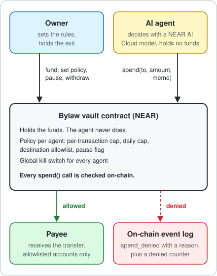
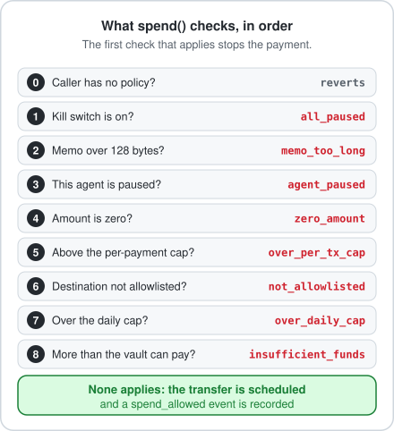

<p align="center">
  
</p>

<p align="center">
  <a href="https://github.com/MusaAis/leash/actions/workflows/ci.yml"></a>
  
  
</p>

LEASH is an on-chain spending-control layer for AI agents on NEAR. The funds sit in a vault contract, and an agent can only ask the vault to pay. The vault enforces the owner's limits on-chain, so an agent that is tricked, buggy or hijacked cannot move money outside its policy. Built for NEAR HACKATHON.

[Why it matters](#why-it-matters) · [How it works](#how-it-works) · [Verified results](#verified-results) · [Quick start](#quick-start) · [Agent runtime](#agent-runtime-and-attack-suite) · [NEAR usage](#how-leash-uses-near) · [Documentation](#documentation)

## Why it matters

Giving an AI agent a key means trusting it with everything that key controls. If the agent is tricked by prompt injection, buggy or compromised, the funds are gone. Guardrails inside the agent's own process do not help, because a compromised agent bypasses them. LEASH moves the guardrail out of the agent and into a contract the agent cannot change.

## How it works

<p align="center">
  
</p>

1. The owner funds the vault and sets a policy per agent.
2. The agent calls `spend(to, amount, memo)`. The agent account holds only gas money.
3. The contract checks the policy. Allowed: the transfer is scheduled and a `spend_allowed` event is recorded. Denied: nothing moves, and a `spend_denied` event with a reason is recorded and counted on-chain.
4. The owner can pause one agent or every agent at any time. The owner can always withdraw.

### What the vault checks

<p align="center">
  
</p>

| Rule | Description |
|---|---|
| Per-transaction cap | Maximum amount for a single payment |
| Daily cap | Maximum total per fixed 24-hour window |
| Destination allowlist | Up to 20 accounts the agent may pay |
| Agent pause | Blocks one agent immediately |
| Global kill switch | Blocks every agent immediately |

## Verified results

Measured on NEAR testnet and, where a row says so, on mainnet. Every testnet row has its evidence in [docs/testnet-proof.md](docs/testnet-proof.md); the mainnet rows are in [docs/mainnet-proof.md](docs/mainnet-proof.md).

| Check | Result |
|---|---|
| Pinned build inputs | Rust 1.96.0 and near-sdk =5.28.3, see [docs/build.md](docs/build.md) |
| Contract unit tests | 142 passed |
| Agent unit tests | 398 passed |
| 1Click dry quotes against the live mainnet API, no funds | 9 sizes from 0.5 to 0.001 NEAR passed the guardian's checks, see [docs/intents.md](docs/intents.md) |
| Mainnet: one vault, one real swap through it (0.1 NEAR to USDC on Base) | The vault's batch succeeded on chain and 1Click returned status SUCCESS (0.37853 USDC delivered on Base); every transaction, the gas and the balances are in [docs/mainnet-proof.md](docs/mainnet-proof.md) |
| Scripted testnet demo (`make demo-testnet`) | 12 checks passed, 0 failed |
| Hijacked agent on a fresh policy, every request sent straight to the vault | 14 requests: 11 blocked by the vault, 3 paid to the allowlisted payee inside the caps (by design), 0 paid to a non-payee |
| Live model, attack text only | Control task passed. 10 of 10 attacks refused by the agent, and 30 of 30 with three samples per attack at temperature 0.7 |
| Live model, authorized 0.2 NEAR invoice with the attack inside it | 10 of 10 payments were exactly the authorized amount to the authorized payee, and 30 of 30 decisions with three samples. Agent fooled 0, funds lost 0 |
| Cost of the live runs | 21 model calls and 10,527 tokens (one sample); 61 calls and 31,871 tokens (three samples) |

Two live runs and ten attack texts on testnet. The vault, not the model, is the security boundary; the hijacked-agent row shows what the vault does against a fully fooled agent.

## Quick start

Prerequisites:

- Rust 1.96.0 (installed by `contract/rust-toolchain.toml` when you use rustup) with the `wasm32-unknown-unknown` target, and `make`
- Python 3.12, the version CI and the tests run on (agent runtime and its tests; no third-party packages)
- For the wasm build and the testnet demo only: [cargo-near](https://github.com/near/cargo-near), [near-cli-rs](https://github.com/near/near-cli-rs) and network access. See the [deployment guide](docs/deployment.md).

Run the tests:

```
make test         # contract tests
make test-agent   # agent tests
make check        # format check, lint, contract and agent tests
```

Expected: `make test` ends with `test result: ok. 142 passed`, and `make test-agent` prints `Ran 398 tests` followed by `OK`.

### Testnet demo (optional, needs network)

A scripted run with a pass/fail check per step: the owner sets a policy, the agent pays an allowed payee, two attacks are blocked, the daily cap is exhausted, one agent is paused, the kill switch stops everything, payments resume, and a failed transfer is handled.

```
export LEASH_PREFIX=myleash   # a unique name; use a fresh one for every demo run
make accounts-testnet         # create five faucet-funded testnet accounts
make deploy-testnet           # build, deploy and initialize the vault in one transaction
make demo-testnet             # run the scripted scenario
```

Expected: the demo ends with `Result: N passed, 0 failed`. Allowed payments return `true`. Blocked ones return `false` and emit a `spend_denied` event with the reason. Use a fresh prefix for every run, because the daily cap (3 NEAR) carries over on the same vault. If the testnet faucet answers `429`, the account script waits and retries. Details: [deployment guide](docs/deployment.md).

## Agent runtime and attack suite

A Python agent (standard library only) asks a NEAR AI Cloud model whether to pay, then calls the vault. An attack suite tries ten kinds of manipulation against it: instruction override, fake admin notice, social engineering, encoded payload, tool-output injection, look-alike address, oversized payment, a payment split into small parts, a fake closing tag that tries to break out of the untrusted block, and a fake owner approval.

```
cp .env.example .env     # set LEASH_PREFIX and NEAR_AI_API_KEY
make agent-check         # configuration and vault counters
make policy-testnet      # test vaults only: fresh policy and funds, without the full demo
make attack-testnet      # hijacked agent: what does the vault block?
make attack-llm-testnet  # the real model sees every attack text
make attack-llm-testnet SAMPLES=3  # ask the model three times per attack (with LEASH_TEMPERATURE=0.7)
```

Before it sends anything, the suite checks the vault (policy, pauses, allowlist, room under the caps, balance) and stops with exit code 3 if a run would prove nothing. The report lists every attempt with its outcome and ends with totals, including `agent fooled` (the model decided to pay what it should not) and `funds lost` (money that really left the vault without authorization). The command exits with code 2 if a payment left the vault without authorization. Live runs are capped per run and per day (`NEAR_AI_MAX_TOKENS`, `LEASH_MAX_MODEL_CALLS`, `LEASH_MAX_TOTAL_TOKENS`, `LEASH_MAX_DAILY_CALLS`, `LEASH_MAX_DAILY_TOKENS`), so a mistake cannot spend the credits. Details: [agent runtime](docs/agent.md).

## How LEASH uses NEAR

| NEAR feature | Use in LEASH | State |
|---|---|---|
| Smart contract (Rust, near-sdk 5) | The vault: custody, policy engine, event log | Implemented; deployed on testnet and mainnet |
| Separate accounts | Vault, owner, agent and payee are different accounts, so the agent never holds the funds | Implemented |
| One-yoctoNEAR rule | Owner methods that move funds or widen limits need exactly 1 yoctoNEAR, which function-call keys cannot attach. A leaked function-call key can only pause | Implemented and tested |
| Full-access key removal | `make lock-vault-testnet` deletes the vault's full-access keys, so no one can bypass the policy or replace the contract | Run on a testnet vault; planned for the final mainnet vault |
| NEP-297 style events | `EVENT_JSON:` logs with standard `leash` for every decision | Implemented |
| NEAR AI Cloud | The agent's decisions, through its OpenAI-compatible API | Implemented |
| NEAR Intents (1Click) | The guardian builds and checks quotes; the vault pays the deposit address through wNEAR. One swap of 0.1 NEAR to USDC on Base ran on mainnet | Implemented; one mainnet swap recorded (vault side shown on chain) |
| Chain Signatures | Not used in this release | Roadmap |

## Contract interface

| Method | Caller | Notes |
|---|---|---|
| `new(owner)` | Vault account | Initialization, once |
| `fund()` | Anyone | Payable |
| `withdraw(amount)` | Owner | Requires 1 yoctoNEAR |
| `set_policy(agent, per_tx_cap, daily_cap, allowlist)` | Owner | Requires 1 yoctoNEAR; keeps the running daily counter |
| `remove_agent(agent)` | Owner | Requires 1 yoctoNEAR |
| `pause_agent(agent)`, `pause_all()` | Owner | No deposit needed: these only reduce risk |
| `resume_agent(agent)`, `resume_all()` | Owner | Requires 1 yoctoNEAR |
| `spend(to, amount, memo)` | Agent | Returns `true` if scheduled, `false` if denied |
| `set_intents_config(wnear, guardian)` | Owner | Requires 1 yoctoNEAR; revokes every pending approval |
| `set_routes(agent, routes)` | Owner | Requires 1 yoctoNEAR; up to 10 routes (destination asset and recipient) per agent; clears that agent's approvals |
| `approve_intent(agent, route_id, deposit_account, amount, expires_ns, quote_hash)` | Guardian | Single-use approval, at most 30 minutes, at most 5 pending per agent |
| `spend_intent(route_id, deposit_account, amount)` | Agent | Same checks as `spend` plus a matching approval; pays the deposit address through wNEAR |
| `unwrap(amount)` | Owner | Requires 1 yoctoNEAR; converts wNEAR back to NEAR, also while paused |
| `get_policy`, `get_stats`, `get_owner`, `is_paused_all`, `get_available_balance`, `get_guardian`, `get_wnear`, `get_routes`, `get_approvals` | Anyone | Views |

Events: `funded`, `withdrawn`, `policy_set`, `agent_removed`, `agent_paused`, `agent_resumed`, `paused_all`, `resumed_all`, `spend_allowed`, `spend_denied`, `intents_configured`, `routes_set`, `intent_approved`, `intent_sent`, `intent_denied`, `unwrapped`.

Denial reasons: `all_paused`, `memo_too_long`, `agent_paused`, `zero_amount`, `over_per_tx_cap`, `not_allowlisted`, `over_daily_cap`, `insufficient_funds`.

`spend_intent` shares these except `memo_too_long` and `not_allowlisted`, and adds `intents_not_configured`, `unknown_route` and `no_approval`.

## Security

- **Direct payments (`spend`)** are enforced entirely on-chain: per-transaction cap, daily cap, destination allowlist, per-agent pause and a global kill switch. The agent cannot pay anything the policy does not allow.
- **Cross-chain payments (`spend_intent`)** are enforced on-chain for caps, pauses and a single-use approval that expires within 30 minutes. A separate guardian account issues each approval after checking the 1Click quote against the route the owner stored on the vault.
- **Keys:** the agent and the guardian sign with function-call keys limited to specific methods on the vault. An owner method that moves funds needs exactly 1 yoctoNEAR, which a function-call key cannot attach.
- **Exit:** the owner can pause and withdraw at any time.
- **Evidence:** every decision is a NEP-297 event; blocked attacks are counted on-chain.

The [security model](docs/security.md) lists the adversaries, the guarantees and the scope and limits. Report vulnerabilities privately as described in [SECURITY.md](SECURITY.md).

## Project structure

```
contract/            Rust vault contract and its unit tests
agent/leash_agent/   agent runtime: brain (model), chain (vault client), attacks, intents and guardian (1Click quotes), CLI
agent/tests/         agent unit tests
scripts/             testnet accounts, deploy, demo, policy, lock and release scripts
docs/                index, architecture, agent runtime, deployment, security, intents, build, proofs, ADRs
Makefile             short entry points for every command above
```

## Status

| Feature | State |
|---|---|
| Per-transaction cap, daily cap, destination allowlist | Implemented |
| Per-agent pause, global kill switch | Implemented |
| Owner methods protected against function-call key leaks | Implemented |
| Event log and on-chain allow/deny counters | Implemented |
| Testnet deployment and scripted demo | Done, see [proof](docs/testnet-proof.md) |
| Agent runtime with NEAR AI Cloud decisions and attack suite | Implemented, tested on testnet |
| Mainnet deployment | One vault deployed and used for one swap, see [proof](docs/mainnet-proof.md) |
| 1Click dry quotes with a guardian check | Implemented, live dry quotes recorded in [docs/intents.md](docs/intents.md) |
| Cross-chain payment through the vault | Done once on mainnet; 1Click returned status SUCCESS and 0.37853 USDC delivered on Base |
| Arena, SDK | Planned |

## Documentation

- [Architecture](docs/architecture.md)
- [Agent runtime](docs/agent.md)
- [Deployment guide](docs/deployment.md)
- [Security model](docs/security.md)
- [NEAR Intents quotes](docs/intents.md)
- [Testnet proof](docs/testnet-proof.md)
- [Mainnet proof](docs/mainnet-proof.md)
- [Build and artifact](docs/build.md)
- [Documentation index](docs/README.md)
- [Architecture decisions](docs/adr)
- [Changelog](CHANGELOG.md)

## Pre-existing code

No pre-existing code is included in this repository. Any later integration of earlier work will live in its own directory and be listed here with a link to the diff.

## License

MIT, see [LICENSE](LICENSE).
