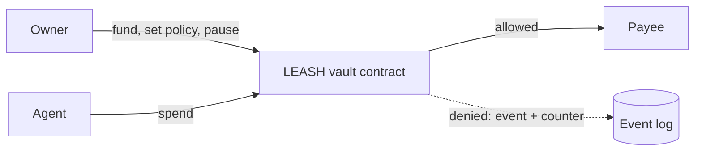

# LEASH

**Give AI money. Keep the leash.**

[](https://github.com/MusaAis/leash/actions/workflows/ci.yml)


LEASH is an on-chain spending-control layer for AI agents on NEAR. Agents can pay, but only inside rules the owner sets and the blockchain enforces. Built for NEAR HACKATHON.

## Why

Giving an AI agent a key means trusting it with everything that key controls. If the agent is tricked, buggy or compromised, the funds are gone. Guardrails inside the agent's own process do not help, because a compromised agent bypasses them.

## How it works

The funds sit in the LEASH vault contract, not in the agent's account. The agent can only ask the vault to pay.

1. The owner funds the vault and sets a policy per agent.
2. The agent calls `spend(to, amount)`.
3. The contract checks the policy. Allowed: funds move. Denied: nothing moves, and a `spend_denied` event with a reason is recorded on-chain.
4. The owner can pause one agent or everything at any time.



## Policy rules

| Rule | Description |
|---|---|
| Per-transaction cap | Maximum amount for a single payment |
| Daily cap | Maximum total per 24-hour window |
| Destination allowlist | Up to 20 accounts the agent may pay |
| Agent pause | Blocks one agent immediately |
| Global kill switch | Blocks every agent immediately |

Denial reasons: `all_paused`, `agent_paused`, `zero_amount`, `over_per_tx_cap`, `not_allowlisted`, `over_daily_cap`, `insufficient_funds`, `memo_too_long`.

## Contract interface

| Method | Caller | Notes |
|---|---|---|
| `new(owner)` | Vault account | Initialization, once |
| `fund()` | Anyone | Payable |
| `withdraw(amount)` | Owner | Requires 1 yoctoNEAR |
| `set_policy(agent, per_tx_cap, daily_cap, allowlist)` | Owner | Requires 1 yoctoNEAR; keeps the running daily counter |
| `remove_agent(agent)` | Owner | Requires 1 yoctoNEAR |
| `pause_agent(agent)`, `pause_all()` | Owner | No deposit needed: these only reduce risk |
| `resume_agent(agent)`, `resume_all()` | Owner | Requires 1 yoctoNEAR |
| `spend(to, amount, memo)` | Agent | Returns `true` if scheduled, `false` if denied |
| `get_policy`, `get_stats`, `get_owner`, `is_paused_all`, `get_available_balance` | Anyone | Views |

Events follow an `EVENT_JSON:` log format with standard `leash`: `funded`, `withdrawn`, `policy_set`, `agent_removed`, `agent_paused`, `agent_resumed`, `paused_all`, `resumed_all`, `spend_allowed`, `spend_denied`.

## Status

| Feature | State |
|---|---|
| Per-transaction cap, daily cap, destination allowlist | Implemented |
| Per-agent pause, global kill switch | Implemented |
| Owner methods protected against function-call key leaks | Implemented |
| Event log and on-chain allow/deny counters | Implemented |
| Testnet and mainnet deployment | In progress |
| Agent runtime, cross-chain payments, Arena, SDK | Planned |

## Quick start

Requirements: Rust (stable) and, for the wasm build, [cargo-near](https://github.com/near/cargo-near).

```
make test    # run the contract tests
make check   # format check, lint and tests
make build   # build the wasm
```

Expected result of `make test`: all tests pass.

## Testnet demo

A scripted run on NEAR testnet: the owner sets a policy, the agent pays an allowed payee, two attacks are blocked, the kill switch stops everything, and payments resume.

```
make accounts-testnet   # create four faucet-funded testnet accounts
make deploy-testnet     # build, deploy and initialize the vault in one transaction
make demo-testnet       # run the scripted scenario
```

Set `LEASH_PREFIX` to a unique name first, for example `export LEASH_PREFIX=myleash`. Allowed payments return `true`; blocked ones return `false` and emit a `spend_denied` event with the reason. Details: [deployment guide](docs/deployment.md). A recorded run with transaction links is in [docs/testnet-proof.md](docs/testnet-proof.md).

## Documentation

- [Deployment guide](docs/deployment.md)
- [Security model](docs/security.md)
- [Architecture decisions](docs/adr)
- [Security policy](SECURITY.md)

## License

MIT
