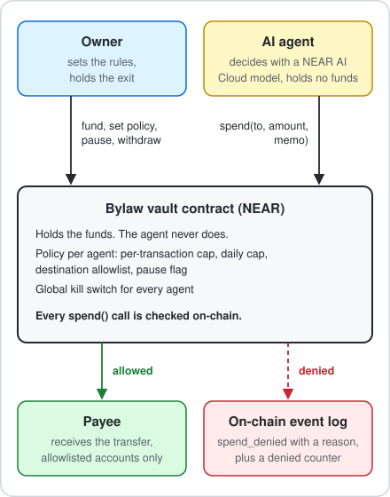
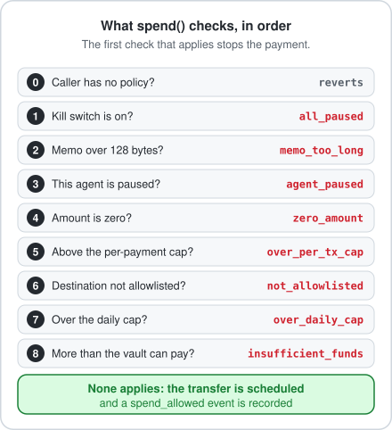

# Architecture

LEASH separates the ability to decide from the ability to pay. The agent decides. The vault contract pays, and only inside the owner's policy.

  

## Components

| Component | Where | Role |
|---|---|---|
| Vault contract | `contract/src/lib.rs` | Holds the funds, stores one policy per agent, checks every `spend`, emits events |
| Agent runtime | `agent/leash_agent/` | Asks a model whether to pay, validates the answer, calls `spend` as the agent account |
| Guardian | `agent/leash_agent/guardian.py` | Builds a 1Click quote request from the route stored on the vault, checks the answer field by field, calls `approve_intent` |
| Intents client | `agent/leash_agent/intents.py` | Calls the 1Click API for the token list, quotes and swap status |
| Attack suite | `agent/leash_agent/attacks.py` | Sends ten kinds of manipulation through the agent or straight to the vault |
| Preflight | `agent/leash_agent/preflight.py` | Checks the vault before an attack run and predicts its answers |
| Scripts | `scripts/` | Create accounts, deploy, set a policy, run the asserted demo, lock the vault |

## Accounts

| Account | Holds | May do |
|---|---|---|
| Vault (`<prefix>-vault.<network>`, on mainnet `leash-vault.near`) | The contract and the funds | Initialize the contract once |
| Owner | Control of policy | Fund, set policy, pause, resume, withdraw |
| Agent | Gas money only | Call `spend` and `spend_intent` |
| Guardian | Gas money only | Call `approve_intent`. It cannot spend, and an agent cannot be the guardian |
| Payee | Nothing special | Receive allowed transfers |

## One payment, step by step

1. The agent runtime gets a task, wraps outside text in `<untrusted>` tags and asks the model for one JSON decision.
2. The runtime validates the answer. Anything unclear becomes a refusal and the vault is never called.
3. For a valid decision, the runtime calls `spend(to, amount, memo)` on the vault, signed as the agent account.
4. The vault runs the checks in this order and stops at the first one that applies.

  

5. If a check applies, the vault returns `false`, emits `spend_denied` with the reason and increases the denied counter. A caller without a policy is reverted and leaves no trace.
6. If none applies, the vault adds the amount to the agent's daily counter, emits `spend_allowed`, schedules the transfer and returns `true`.

## A cross-chain payment, step by step

1. The owner stores a route for the agent with `set_routes` (destination asset and recipient) and names the guardian and the wNEAR contract with `set_intents_config`.
2. The agent gives the guardian a route id and an amount. The guardian reads the route from the vault, builds the 1Click request itself and verifies the answer. See [NEAR Intents quotes](intents.md).
3. The guardian calls `approve_intent` with the deposit address, the amount and an expiry of at most 30 minutes. The approval is single use and matches one amount exactly.
4. The agent calls `spend_intent(route_id, deposit_account, amount)`. The vault checks, in order: intents configured, kill switch, agent pause, zero amount, known route, per-payment cap, a matching unexpired approval, daily cap, available funds. A caller without a policy is reverted.
5. A denial returns `false`, emits `intent_denied` with the reason and increases the denied counter. Otherwise the vault consumes the approval, adds the amount to the daily counter, emits `intent_sent` and sends one batch to the wNEAR contract: two storage registrations, `near_deposit` and `ft_transfer` to the deposit address.
6. The owner can turn wNEAR left in the vault back into NEAR with `unwrap`, also while paused.

The mainnet run of this path is in the [mainnet proof](mainnet-proof.md).

## Where each guarantee is enforced

| Guarantee | Enforced by |
|---|---|
| The agent cannot pay a destination that is not allowlisted | Vault, check 6 |
| The agent cannot exceed the per-payment or daily limit | Vault, checks 5 and 7 |
| A prompt-injected model cannot change the policy | Owner methods require the owner account and exactly 1 yoctoNEAR |
| The owner can stop one agent or all agents at once | `pause_agent`, `pause_all`, no deposit needed |
| The owner can always get the funds back | `withdraw`, not blocked by pause |
| The guardian cannot spend and the agent cannot approve | `approve_intent` accepts only the guardian, `spend` and `spend_intent` only an agent with a policy |
| A swap needs an approval for its exact amount and deposit address | Vault, the approval check of `spend_intent`; approvals expire and stop matching after `set_intents_config` |
| Every decision can be audited | Events with standard `leash` on every allow and deny |

## Events

Each event is logged as `EVENT_JSON:` followed by `{"standard":"leash","version":...,"event":...,"data":[...]}`.

| Event | Data fields |
|---|---|
| `funded` | `from`, `amount` |
| `withdrawn` | `amount` |
| `policy_set` | `agent`, `per_tx_cap`, `daily_cap` |
| `agent_removed`, `agent_paused`, `agent_resumed` | `agent` |
| `paused_all`, `resumed_all` | none |
| `spend_allowed` | `agent`, `to`, `amount`, `memo` |
| `spend_denied` | `agent`, `to`, `amount`, `reason`, `memo` |
| `intents_configured` | `wnear`, `guardian`, `epoch` |
| `routes_set` | `agent`, `count` |
| `intent_approved` | `agent`, `route_id`, `deposit_account`, `amount`, `expires_ns`, `quote_hash` |
| `intent_sent` | `agent`, `route_id`, `deposit_account`, `amount`, `quote_hash` |
| `intent_denied` | `agent`, `route_id`, `deposit_account`, `amount`, `reason` |
| `unwrapped` | `amount` |

Amounts are in yoctoNEAR, as strings.

## Related documents

[Security model](security.md) · [NEAR Intents quotes](intents.md) · [Agent runtime](agent.md) · [Deployment guide](deployment.md) · [Architecture decisions](adr)
